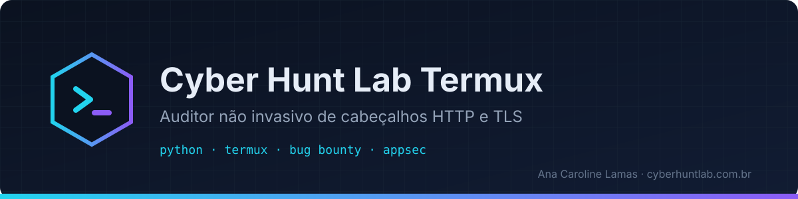

<p align="center"></p>

# Cyber Hunt Lab Termux — auditor de cabeçalhos HTTP e TLS

Scanner em Python de **configuração de segurança HTTP/TLS**, não invasivo, pensado para rodar no **Termux (Android)** durante auditorias autorizadas e programas de **bug bounty**. Ele faz no máximo três requisições GET a um único host declarado, verifica cabeçalhos de segurança, cookies, CORS e o certificado TLS, e gera relatórios em JSON, Markdown e HTML.

Não é um pentest completo: não faz fuzzing, exploração, crawling, força bruta nem autenticação.

## Recursos

- **Escopo travado**: exige o host exato autorizado e a confirmação `AUTORIZADO` antes de começar.
- **Proteções de rede**: aceita somente HTTP(S) nas portas 80/443, recusa URLs com credenciais e bloqueia destinos com IP privado ou interno.
- **Redirecionamentos controlados**: segue no máximo 3 saltos e interrompe se o destino sair do host autorizado.
- **Cabeçalhos de segurança**: verifica HSTS, Content-Security-Policy, X-Content-Type-Options, Referrer-Policy e Permissions-Policy.
- **Cookies e CORS**: aponta a falta de `Secure`, `HttpOnly` e `SameSite` e a presença de `Access-Control-Allow-Origin: *`.
- **TLS**: registra a versão do protocolo, a cifra, a validade do certificado e o resultado da validação.
- **Respeita o servidor**: intervalo mínimo de 1 s entre requisições e parada imediata ao receber HTTP 429.
- **Resumo opcional com IA**: envia apenas os achados sanitizados para a API da OpenAI.

## Instalação

### Termux (Android)

```bash
pkg update -y
pkg install -y python ca-certificates
python -m pip install -r requirements.txt
```

Ou execute o script incluído:

```bash
bash install.sh
```

### Linux / macOS

```bash
python3 -m pip install -r requirements.txt
```

Requisitos: Python 3.9+ e `requests` (>=2.32, <3).

## Como usar

Modo interativo (pede URL, host e confirmação):

```bash
python scanner.py
```

Modo direto, para um domínio que você controla ou está autorizado a testar:

```bash
python scanner.py --url https://seu-dominio.example/ --scope-host seu-dominio.example --yes-authorized
```

| Opção | Descrição | Padrão |
|---|---|---|
| `--url` | URL inicial do alvo | perguntado |
| `--scope-host` | Host exato autorizado | perguntado |
| `--yes-authorized` | Confirma a autorização sem prompt | desativado |
| `--max-requests` | Requisições GET por execução (1–3) | `2` |
| `--delay` | Intervalo entre requisições, em segundos (mín. 1) | `2` |
| `--ai` | Adiciona resumo gerado pela API da OpenAI | desativado |
| `--model` | Modelo usado com `--ai` (ou `OPENAI_MODEL`) | `gpt-4.1-mini` |

### Resumo com IA (opcional)

A chave fica só na variável de ambiente e nunca no código:

```bash
read -rsp 'OpenAI API key: ' OPENAI_API_KEY; echo
export OPENAI_API_KEY
python scanner.py --ai
unset OPENAI_API_KEY
```

O uso da API é cobrado à parte. Não envie dados privados de programas de bug bounty a provedores externos sem permissão.

## Relatórios

Cada execução grava três arquivos em `reports/`:

- `audit-AAAAMMDDTHHMMSSZ.json` — dados completos;
- `audit-…md` — relatório legível;
- `audit-…html` — versão para navegador.

Achados com status `OBSERVATION` são sinais para revisão, **não** vulnerabilidades confirmadas.

## Limitações

- A checagem é superficial e não comprova XSS, SQLi, IDOR, CSRF ou outras falhas exploráveis, nem confirma CVEs/CWEs.
- O DNS é validado antes da conexão, mas a biblioteca `requests` resolve o nome de novo; um host sujeito a *DNS rebinding* pode contornar a verificação. Não use contra hosts não confiáveis ou dinâmicos.
- O `Set-Cookie` é analisado de forma agregada, sem auditoria individual de cada cookie.
- Os corpos das respostas não são lidos integralmente, o que reduz o consumo de dados.
- Estar listado numa plataforma de bug bounty **não** significa que toda técnica é permitida: consulte sempre o escopo e as regras do programa.

## Tecnologias

Python 3 · requests · ssl/socket (biblioteca padrão) · API da OpenAI (opcional) · Termux

## Licença

Distribuído sob a licença MIT. Veja [LICENSE](LICENSE).
